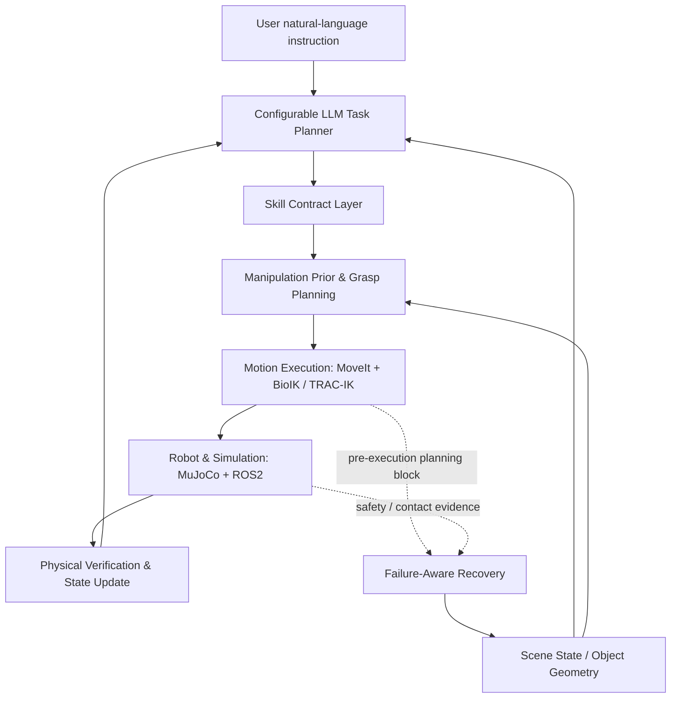
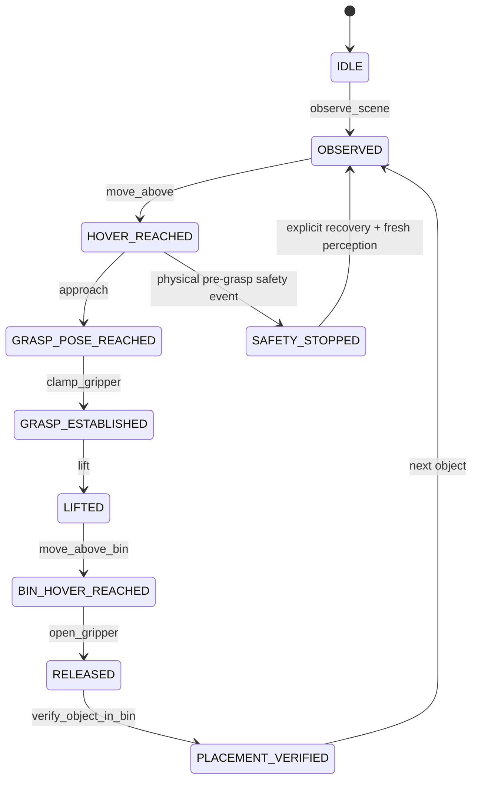

# Architecture

NERO deliberately separates probabilistic task reasoning from deterministic robot execution.

## Control boundary

The LLM may choose **what skill to call and with what high-level argument**. It may not send joint angles or bypass safety state. The backend validates state transitions and measures whether the physical postcondition was actually achieved.

## Skill state machine

A planning refusal before execution is handled separately because no physical contact has occurred; it does not require clearing a safety latch.

## Manipulation prior

The current prior is deliberately simple and interpretable. It expands the pre-grasp aperture beyond nominal object width and uses different clearances for boxes and spheres. Retry bonuses are task-local and are cleared at a fresh episode boundary.

This is a useful placeholder for future tactile- or data-driven priors because every chosen aperture, geometry estimate, failure, and outcome is already observable in the log.
