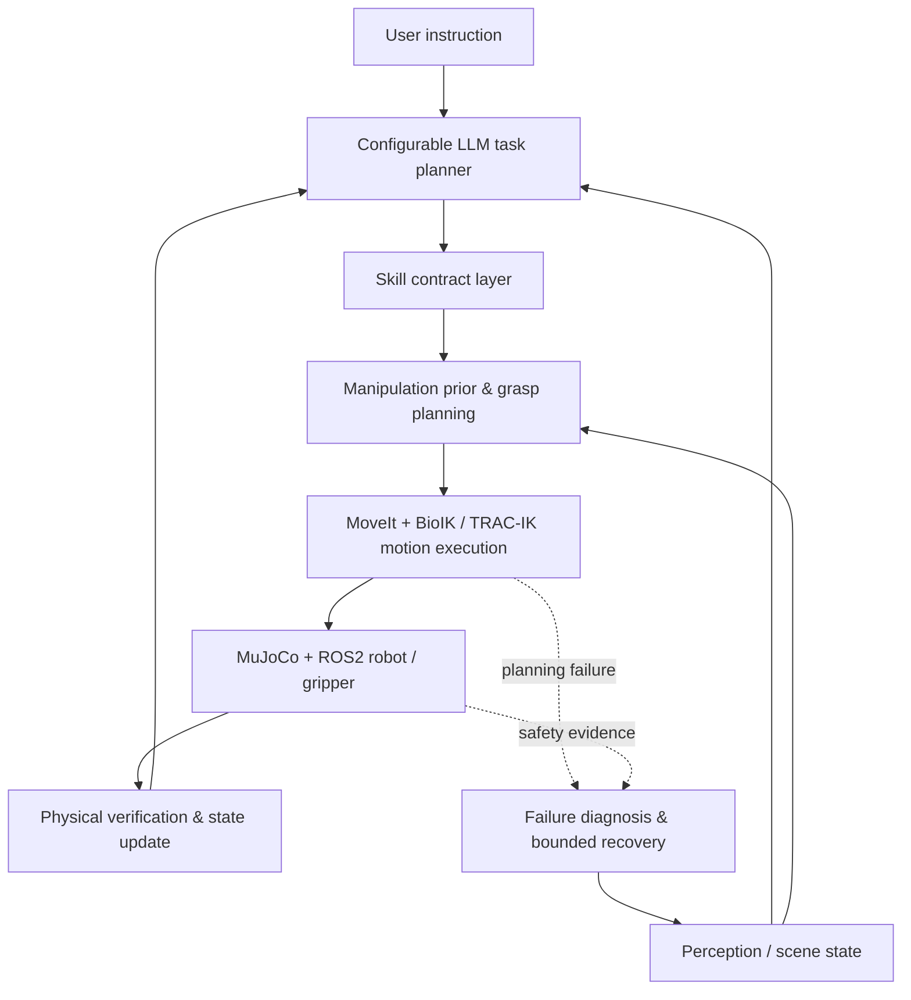

# NERO V2-6 Public Release

**LLM-guided robotic manipulation with deterministic skill contracts, manipulation priors, physical verification, and bounded failure recovery.**

NERO is a hands-on manipulation stack for a simulated AgileX NERO 7-DOF arm in MuJoCo. A configurable LLM plans at the **skill level**; MoveIt/BioIK/TRAC-IK and the backend remain responsible for geometry, execution, safety state, and measured postconditions.

> **Release status:** GitHub public preview `v0.1.0` / internal stack version `V2-6`. This release is based on the V2-5.2 build that completed a sequential same-color sorting task in MuJoCo. The observed ~140 s run with GPT-5.6 Luna is a demo result, **not a benchmark claim**.

## What is interesting here

NERO does not ask an LLM to invent joint angles. It separates high-level reasoning from robot execution:



Key engineering ideas:

- **Continuous gripper aperture** in millimeters, not only open/closed.
- **Shape-aware manipulation priors** that add practical clearance before approach.
- **Skill contracts** defining preconditions, intended effects, non-effects, and success criteria.
- **Physical postcondition checks** after motion rather than trusting planner/controller return codes alone.
- **Planning-failure adaptation** for pre-contact Cartesian collision-check failures.
- **Failure-aware safety recovery** with a fresh observation and at most one modified retry.
- **Multi-object completion guard** so a fast LLM cannot silently stop after completing only the first object.
- **Fresh episode reset** so `ZERO ALL -> RUN TASK` does not inherit stale hover/retry state.

## Demo

A useful public demo task is:

```text
Put the red objects to the bin with the same color, one by one.
```

A broader sorting task is:

```text
Pick the objects one by one, and put them into the bin with the same color.
```

The expected high-level cycle is:

```text
observe -> choose target -> set aperture -> move_above -> approach
-> grasp -> lift -> transport -> release -> verify -> next target
```

See [YOUTUBE_DEMO.md](YOUTUBE_DEMO.md) for a recording checklist, [examples/demo_tasks.txt](examples/demo_tasks.txt) for task prompts, and [BENCHMARKING.md](BENCHMARKING.md) before publishing quantitative claims.

## Repository layout

```text
NERO_V2_6_Agent.py                    LLM planner + tool schemas + completion guard
NERO_V2_6_Unified_Backend.py          MuJoCo/ROS2 GUI, skill contracts, verification, recovery
NERO_V69_ReachableZone_BioIK_Planner_Core.py
                                      frozen motion core used by the validated stack
start_nero_v2_6.sh                    one-command launcher for an established NERO workspace
ARCHITECTURE.md                       design and state-machine notes
QUICKSTART.md                         setup / launch instructions
YOUTUBE_DEMO.md                       recording and presentation checklist
BENCHMARKING.md                        suggested quantitative evaluation
benchmarks/results_template.csv        experiment result template
CHANGELOG.md                          release history
examples/demo_tasks.txt               repeatable demo prompts
config/nero.env.example               configurable paths / model settings
config/pricing.example.json           optional cost-estimation schema
release_check.sh                      static release checks
```

## Quick start

This repository **does not redistribute vendor assets or ROS workspaces**. It expects an already working local NERO setup with:

- Ubuntu 22.04 / ROS 2 Humble
- AgileX NERO MoveIt workspace
- MuJoCo Python environment
- BioIK and TRAC-IK workspaces
- an existing `~/mujoco_ws/nero/nero_motor.xml`
- an OpenAI API key if using the included LLM planner

Then:

```bash
git clone git@github.com:Xeon87/NERO-GPT-Agent-Manipulation-Test.git
cd NERO-GPT-Agent-Manipulation-Test
bash start_nero_v2_6.sh
```

HTTPS clone works as well if SSH is not configured.

For a different workspace layout, export paths first; see [config/nero.env.example](config/nero.env.example).

## LLM model selection

The code is **not tied to GPT-5.6 Luna**. `GPT-5.6 Luna` is simply one model used during validation. The GUI model field is editable and the **Refresh API Models** button can list model IDs visible to the configured API key.

Environment configuration:

```bash
export NERO_LLM_MODEL="<your-model-id>"
export OPENAI_API_KEY="..."
```

The current public release uses the OpenAI Responses API for the planner transport. In other words, the **model is configurable; the API provider is not yet abstracted**.

## Failure handling

NERO distinguishes failures that happen at different layers:

1. **Planning block before execution** — no physical contact occurred. The stack may widen the aperture / adjust grasp height and retry once.
2. **Physical pre-grasp safety stop** — the safety latch remains authoritative. The planner must inspect evidence, explicitly recover, re-perceive, materially change strategy, and retry at most once.
3. **Postcondition failure** — the commanded motion may have returned success but the measured TCP/object state did not satisfy the skill contract.

The goal is not unlimited autonomy; the goal is **bounded, inspectable recovery**.

## Known limitations

- MuJoCo simulation only in this public release.
- Demo scene uses a fixed set of named objects and bins.
- Object pose/geometry can come directly from simulator state; D435i visual perception is optional rather than required by this release.
- Manipulation priors are hand-crafted engineering heuristics, not learned policies.
- Primary grasp style is top-down, two-finger grasping.
- Failure taxonomy and recovery strategies are intentionally limited and bounded.
- No tactile feedback is in the closed loop yet.
- OpenAI Responses API is the only implemented LLM transport in `v0.1.0`.

These limitations are deliberate. The project is intended as an applied manipulation testbed where perception, tactile sensing, calibration, and recovery can be added without hiding the deterministic robot layer behind the LLM.

## Safety

This release was validated in simulation. **Do not transfer automatic recovery behavior directly to real hardware without independent hardware limits, E-stop validation, collision thresholds, speed/force limits, and supervised testing.**

## Reproducibility / logs

Runtime logs are written under `$NERO_WS/logs`. When reporting an issue, include:

- the exact task prompt;
- selected model and reasoning setting;
- `observe_scene` snapshot around the failure;
- the relevant `SKILL CONTRACT`, `PHYSICAL VERIFY`, planning/safety-recovery lines;
- whether the run started after `ZERO ALL` or a full restart.

Never upload an API key or secret in an issue/log.

## License and third-party components

The repository includes project code but relies on third-party ROS, MoveIt, MuJoCo, BioIK, TRAC-IK, and AgileX assets/packages that keep their own licenses. See [THIRD_PARTY_NOTICES.md](THIRD_PARTY_NOTICES.md). The included `LICENSE.md` is intentionally conservative for this preview; choose an open-source license only after confirming ownership and third-party obligations.

## Citation

If you reference the public preview, use the project name **NERO: LLM-Guided Robotic Manipulation with Manipulation Priors and Failure-Aware Recovery** and the release tag `v0.1.0`.
